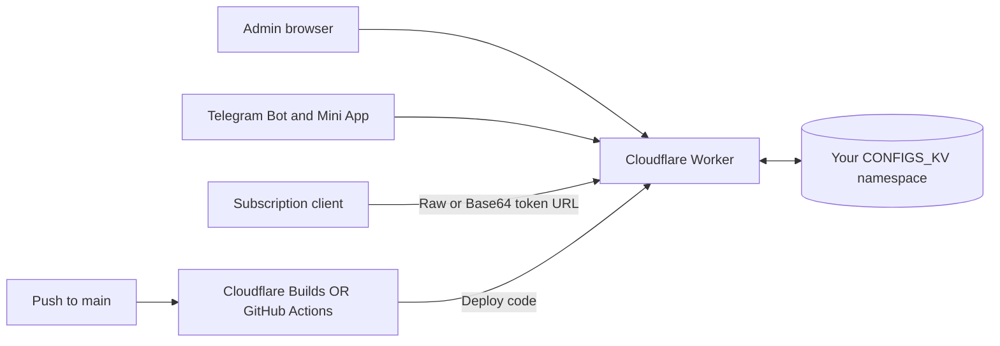

<div align="center">
  
  <h1>Config Pilot</h1>
  <p><strong>مدیریت دو‌زبانهٔ کانفیگ‌ها، روی حساب Cloudflare خودتان.</strong></p>
  <p>
    <a href="https://developers.cloudflare.com/workers/"></a>
    <a href="https://developers.cloudflare.com/kv/"></a>
    <a href="https://core.telegram.org/bots"></a>
    <a href="LICENSE"></a>
    <a href="https://github.com/erfan-tahvilian/config-pilot/actions/workflows/ci.yml"></a>
  </p>
  <p><a href="README.md">English</a> · <a href="README.fa.md">فارسی</a> · <a href="#deploy">نصب و انتشار</a> · <a href="#auto-deploy">انتشار خودکار</a> · <a href="https://github.com/erfan-tahvilian/config-pilot/issues">گزارش مشکل</a></p>
</div>

---

<div dir="rtl">

پنل مدیریت کانفیگ اشتراک روی Cloudflare Workers و KV، با پنل و ربات تلگرام فارسی/انگلیسی. هر فرد نسخهٔ مستقل خود را با منابع حساب Cloudflare خودش راه‌اندازی می‌کند.

> Config Pilot متن کانفیگ را ذخیره و به‌صورت اشتراک ارائه می‌کند. این پروژه سرور VPN راه‌اندازی نمی‌کند، اطلاعات اتصال معتبر تولید نمی‌کند و در دسترس بودن سرورهای مقصد را نمی‌سنجد.

## فهرست راهنما

[قابلیت‌ها](#features) · [معماری](#architecture) · [نصب](#deploy) · [انتشار خودکار](#auto-deploy) · [تلگرام](#telegram) · [دامنه](#domain) · [استفادهٔ روزمره](#usage) · [توسعهٔ محلی](#development) · [تنظیمات](#configuration) · [بکاپ و بازیابی](#operations) · [API](#api) · [رفع خطا](#troubleshooting) · [مشارکت](#contributing) · [مجوز](#license)

<a id="features"></a>
## قابلیت‌ها

- ساخت، تغییر نام، فعال/غیرفعال کردن و حذف کاربر، با توکن اشتراک مستقل.
- مدیریت کانفیگ اختصاصی و لینک اشتراک Raw و Base64 برای هر کاربر.
- آپلود فایل متنی، پاک‌سازی فاصله‌ها، حذف کانفیگ تکراری، دانلود TXT و بازیابی کانفیگ ذخیره‌شدهٔ قبلی.
- کپی اختیاری کانفیگ هنگام ساخت کاربر یا از صفحهٔ کاربر موجود. کپی مستقل است و جایگزینی کانفیگ ذخیره‌شدهٔ مقصد همراه با بکاپ است.
- جایگزینی یا افزودن کانفیگ برای همه یا تعدادی از کاربران، با منبع متن، فایل یا کاربر دیگر.
- پنل فارسی راست‌به‌چپ و انگلیسی چپ‌به‌راست، با تم روشن/تاریک و ذخیرهٔ انتخاب‌ها در مرورگر. متن کانفیگ و لینک‌ها همیشه چپ‌به‌راست است. دکمه در تم روشن ماه و در تم تاریک خورشید نشان می‌دهد.
- مدیریت کاربران، کانفیگ، فایل و عملیات گروهی از ربات تلگرام؛ احراز هویت مینی‌اپ و انتخاب زبان مستقل ربات.

<a id="architecture"></a>
## معماری

<div dir="ltr">



</div>

پنل، API، لینک اشتراک و وبهوک ربات در `worker.js` اجرا می‌شوند. داده‌ها داخل namespace اختصاصی KV شما هستند. عمومی شدن یا به‌روزرسانی کد مخزن، کاربران و کانفیگ‌های ذخیره‌شدهٔ شما را به GitHub منتقل نمی‌کند.

| هدف شما | مسیر راه‌اندازی |
| --- | --- |
| اولین نصب و انتشار | [نصب دستی](#deploy) |
| انتشار بعد از هر پوش | [Cloudflare Builds یا GitHub Actions](#auto-deploy) |
| امتحان روی رایانه | [توسعهٔ محلی](#development) |
| به‌روزرسانی نصب قبلی | [نگهداری و بازیابی](#operations) |

<a id="deploy"></a>
## نصب نسخهٔ شخصی

به حساب Cloudflare با دسترسی Workers و KV، ابزار Git و **Node.js نسخهٔ ۲۲ یا جدیدتر** نیاز دارید؛ گردش‌کار آماده از Node.js 24 استفاده می‌کند. برای انتشار خودکار، حساب GitHub و مخزن خودتان لازم است. ربات تلگرام و دامنهٔ اختصاصی اختیاری‌اند.

اگر می‌خواهید تغییرات و تنظیمات انتشار خودتان را داشته باشید ابتدا پروژه را Fork کنید؛ در دستور زیر آدرس فورک خودتان را جایگزین کنید.

<div dir="ltr">

```sh
git clone https://github.com/erfan-tahvilian/config-pilot.git
cd config-pilot
npm ci
npx wrangler login
```

</div>

۱. فایل `wrangler.example.toml` را با نام `wrangler.toml` کپی کنید و نام Worker را انتخاب کنید. این فایل شخصی در Git ثبت نمی‌شود. در لینوکس/مک از `cp wrangler.example.toml wrangler.toml` و در PowerShell از `Copy-Item wrangler.example.toml wrangler.toml` استفاده کنید.

۲. دستور `npx wrangler kv namespace create CONFIGS_KV` را اجرا کنید. شناسهٔ خروجی را جای `REPLACE_WITH_YOUR_KV_NAMESPACE_ID` در تنظیمات محلی بگذارید. نام binding باید دقیقاً **`CONFIGS_KV`** بماند.

۳. یک رمز اولیهٔ اختصاصی با حداقل ۸ کاراکتر به‌صورت Cloudflare Secret ثبت کنید:

<div dir="ltr">

```sh
npx wrangler secret put ADMIN_PASSWORD
```

</div>

رمز را در ورودی دستور وارد کنید. اگر در اولین اجرا Wrangler اجازهٔ ساخت Worker خواست، تأیید کنید و سپس انتشار کد مرحلهٔ بعد را انجام دهید. نصب جدید **رمز پیش‌فرض مشترک ندارد**. در اولین ورود موفق، هش SHA-256 رمز در KV ذخیره می‌شود. ورودهای بعدی از رمز ثبت‌شده استفاده می‌کنند؛ تغییر Secret اولیه، رمز ثبت‌شده را بازنویسی نمی‌کند. پس از راه‌اندازی، رمز را از پنل تغییر دهید. نصب‌های قبلی رمز ذخیره‌شدهٔ خود را حفظ می‌کنند؛ اگر هنوز از رمز قدیمی `admin` استفاده می‌کنید آن را تغییر دهید.

۴. تست و انتشار:

<div dir="ltr">

```sh
npm test
npx wrangler deploy --dry-run
npm run deploy
```

</div>

۵. آدرس `https://YOUR_WORKER_HOST/admin` را باز کنید و وارد شوید.

نمونه، آدرس `workers.dev` را فعال می‌کند. اگر آن را غیرفعال می‌کنید، دامنه و route خودتان را تنظیم کنید. متغیر اختیاری `PUBLIC_BASE_URL` آدرس پایهٔ عمومی لینک‌های اشتراک را تنظیم می‌کند.

<a id="auto-deploy"></a>
## انتشار خودکار بعد از پوش روی `main`

برای محیط اصلی **یکی** از دو روش زیر را فعال کنید تا هر پوش دوبار منتشر نشود. [گردش‌کار آماده](.github/workflows/ci.yml) همیشه تست و ساخت آزمایشی را اجرا می‌کند؛ مرحلهٔ انتشار آن تا فعال‌سازی صریح شما خاموش است.

### روش A · اتصال مستقیم Cloudflare به GitHub

ابتدا نصب دستی بالا را انجام دهید. برای Worker موجود، در **Workers & Pages → Worker → Settings → Builds → Connect** به GitHub متصل شوید و مخزن خودتان و شاخهٔ `main` را انتخاب کنید. نام Worker و تنظیمات تولیدشده باید یکسان باشند. [راهنمای رسمی اتصال مخزن](https://developers.cloudflare.com/workers/ci-cd/builds/).

مقادیر مخصوص این پروژه:

| بخش | مقدار |
| --- | --- |
| شاخهٔ اصلی انتشار | `main` |
| پوشهٔ ریشه | ریشهٔ مخزن (`/`) |
| Build command | `npm ci && npm test && npm run configure` |
| Deploy command | `npm run deploy` |
| متغیر ساخت `CONFIG_PILOT_KV_NAMESPACE_ID` | شناسهٔ namespace اختصاصی شما |
| متغیر ساخت `CONFIG_PILOT_WORKER_NAME` | نام دقیق Worker موجود |
| متغیر اختیاری ساخت `PUBLIC_BASE_URL` | آدرس پایهٔ HTTPS عمومی |

دستور `npm run configure` فایل محلی و نادیده‌گرفته‌شدهٔ `wrangler.toml` را از این مقادیر می‌سازد و بازنویسی می‌کند؛ رمز یا توکن API در آن نوشته نمی‌شود. **`ADMIN_PASSWORD` را به‌صورت Secret زمان اجرای Worker تنظیم کنید**؛ صرفاً متغیر Build کافی نیست. [توضیح تفاوت متغیرهای ساخت و اجرا](https://developers.cloudflare.com/workers/ci-cd/builds/configuration/).

یک کامیت روی `main` پوش کنید و گزارش ساخت را در Cloudflare ببینید. در این روش متغیر `DEPLOY_TO_CLOUDFLARE` را در GitHub فعال نکنید.

### روش B · گردش‌کار آمادهٔ GitHub Actions

در مخزن خودتان به **Settings → Secrets and variables → Actions** بروید و این مقادیر را اضافه کنید:

| نوع | نام | مقدار |
| --- | --- | --- |
| Secret | `CLOUDFLARE_API_TOKEN` | توکن API محدود به حساب انتشار شما |
| Secret | `CLOUDFLARE_ACCOUNT_ID` | شناسهٔ حساب Cloudflare |
| Secret | `CONFIG_PILOT_KV_NAMESPACE_ID` | شناسهٔ namespace، بدون نقل‌قول و فاصله |
| Secret | `ADMIN_PASSWORD` | رمز اولیهٔ اختصاصی با حداقل ۸ کاراکتر |
| Variable | `CONFIG_PILOT_WORKER_NAME` | نام Worker؛ پیش‌فرض `config-pilot` |
| Variable | `PUBLIC_BASE_URL` | آدرس پایهٔ HTTPS؛ اختیاری |
| Variable | `DEPLOY_TO_CLOUDFLARE` | برای فعال شدن انتشار دقیقاً `true` |

توکن **Edit Cloudflare Workers** بسازید و دسترسی‌اش را به حساب هدف محدود کنید؛ برای دامنه و route، دسترسی zone مربوط نیز لازم است. برای ساخت توکن و یافتن شناسهٔ حساب، [راهنمای رسمی احراز هویت](https://developers.cloudflare.com/workers/ci-cd/external-cicd/github-actions/) را دنبال کنید. کلید عمومی حساب یا توکن واقعی را داخل مخزن ننویسید.

گردش‌کار از [اکشن رسمی Wrangler](https://github.com/cloudflare/wrangler-action) با نسخهٔ ثابت‌شده به کامیت استفاده می‌کند؛ تنظیمات را می‌سازد و `ADMIN_PASSWORD` را به‌صورت Secret در Worker قرار می‌دهد. تست‌ها باید پیش از انتشار موفق شوند. روی `main` پوش کنید یا در **Actions → Checks and deploy → Run workflow**، شاخهٔ `main` را انتخاب کنید. اگر در فورک درخواست فعال‌سازی Actions نمایش داده شد، آن را فعال کنید. با خالی گذاشتن متغیر فعال‌سازی، فقط تست‌ها اجرا می‌شوند.

### بررسی انتشار

پس از موفق شدن انتشار، `/admin` را باز کنید، وارد شوید، یک کاربر آزمایشی بسازید، کانفیگ ذخیره کنید و لینک Raw را بررسی کنید. پس از انتشار مجدد کد باید کاربران باقی بمانند. شناسهٔ namespace قبلی را حفظ کنید؛ namespace جدید، مجموعه‌دادهٔ جدید است.

<a id="telegram"></a>
## اتصال تلگرام

با BotFather ربات بسازید. در بخش تلگرام پنل، توکن ربات و شناسهٔ عددی ادمین را وارد کنید، ربات را فعال کنید و ذخیره بزنید. وبهوک و لیست دستورها ثبت می‌شوند. فقط ادمین تنظیم‌شده می‌تواند از طریق ربات مدیریت کند. در ربات `/start` بفرستید یا از دکمهٔ پیام تست پنل استفاده کنید.

برای مینی‌اپ، آدرس `https://YOUR_WORKER_HOST/tg-app` را در BotFather بخش `/myapps` ثبت کنید و آن را داخل تلگرام باز کنید.

برای تغییر زبان ربات از **🌐 زبان / Language**، دستور `/language` یا دستورهای مستقیم `/language en` و `/language fa` استفاده کنید. انتخاب در KV و مستقل از زبان پنل ذخیره می‌شود. تغییر زبان عملیات نیمه‌تمام را لغو نمی‌کند و دکمه‌های قدیمی هر دو زبان همچنان کار می‌کنند. نام کاربران، لینک‌ها و متن کانفیگ ترجمه نمی‌شوند.

راهنما از `/help`، `/commands` و `/file` در دسترس است. نمونه:

<div dir="ltr">

```text
/setconfigs USER_ID
vless://...
```

</div>

منظور از `USER_ID` شناسهٔ داخلی کاربر پنل، مانند `u_xxxxx` است، نه شناسهٔ تلگرام. آن را از بخش مدیریت کاربران بگیرید. ارسال فایل متنی با همین دستور در کپشن نیز پشتیبانی می‌شود.

<a id="domain"></a>
## دامنهٔ اختصاصی

از مسیر **Worker → Settings → Domains & Routes → Add → Custom Domain** دامنه را اضافه کنید. دامنه باید در حساب Cloudflare شما در دسترس باشد. [راهنمای رسمی دامنهٔ اختصاصی](https://developers.cloudflare.com/workers/configuration/routing/custom-domains/).

برای ساخت لینک اشتراک با این دامنه، `PUBLIC_BASE_URL` را مثلاً برابر `https://configs.example.com` بگذارید. این متغیر خودش DNS را تنظیم نمی‌کند. در انتشار دستی، بخش `[vars]` فایل محلی را از کامنت خارج کنید؛ در انتشار خودکار از متغیر جدول مربوط استفاده کنید. برای انتقال ربات به میزبان جدید، پنل را روی دامنهٔ جدید باز کنید و تنظیمات تلگرام را دوباره ذخیره کنید؛ URL مینی‌اپ BotFather را نیز به‌روز کنید.

<a id="usage"></a>
## استفادهٔ روزمره

| کار | مسیر در پنل |
| --- | --- |
| کاربر جدید بدون کانفیگ | کاربران ← نام ← خالی گذاشتن منبع کپی ← ایجاد |
| کاربر جدید با کانفیگ کپی‌شده | کاربران ← نام ← انتخاب منبع اختیاری ← ایجاد |
| کپی روی کاربر موجود | کانفیگ کاربر ← انتخاب مقصد و منبع دیگر ← کپی ← تأیید |
| ویرایش کانفیگ | انتخاب کاربر ← متن یا فایل ← انتخاب پاک‌سازی/حذف تکراری ← ذخیره |
| ارائهٔ اشتراک | کپی لینک Raw یا Base64 همان کاربر در کلاینت سازگار |
| عملیات گروهی | نوع جایگزینی/افزودن، محدوده و منبع ← اعمال |
| بازیابی | انتخاب کاربر مقصد ← بازیابی بکاپ ← تأیید |
| زبان و ظاهر | دکمه‌های بالای پنل |

لینک اشتراک حکم اطلاعات دسترسی را دارد: هر فرد دارای لینک می‌تواند کانفیگ کاربر فعال را بخواند. غیرفعال‌سازی کاربر دسترسی را متوقف می‌کند. ساخت توکن جدید لینک قبلی را باطل می‌کند و باید لینک کلاینت را هم تغییر دهید. کپی کانفیگ، نام، شناسه، وضعیت یا توکن را کپی نمی‌کند.

<details>
<summary><strong>جدول دستورهای ربات تلگرام</strong></summary>

| دستور | کاربرد |
| --- | --- |
| `/start`، `/help`، `/commands`، `/file` | منو و راهنما |
| `/language`، `/language fa`، `/language en` | زبان ربات |
| `/id` | شناسهٔ تلگرام ادمین ثبت‌شده |
| `/users`، `/newuser`، `/adduser NAME` | فهرست و ایجاد کاربر |
| `/configs ID` | خلاصه و پیش‌نمایش کانفیگ |
| `/setconfigs ID`، `/appendconfigs ID` | جایگزینی/افزودن با خطوط بعدی پیام یا کپشن فایل |
| `/bulk` | عملیات گروهی با دکمه |
| `/apply_all`، `/append_all` | جایگزینی/افزودن برای همه |
| `/apply_users id1,id2`، `/append_users id1,id2` | جایگزینی/افزودن برای افراد انتخاب‌شده |
| `/enable ID`، `/disable ID`، `/deluser ID` | وضعیت و حذف کاربر |
| `/password NEW_PASSWORD` | تغییر رمز پنل؛ خود رمز در متن پیام تلگرام قرار می‌گیرد |
| `/webhook` | تنظیم دوبارهٔ وبهوک و دستورها |
| `/cancel` | لغو عملیات نیمه‌تمام |

دکمه‌های تعاملی ربات، تغییر نام، ساخت توکن و تأیید حذف را نیز دارند. اگر نمی‌خواهید رمز در تاریخچهٔ تلگرام باقی بماند، رمز را از پنل تغییر دهید.

</details>

<a id="development"></a>
## توسعهٔ محلی

فایل `wrangler.example.toml` را با نام `wrangler.toml` و فایل `.dev.vars.example` را با نام `.dev.vars` کپی کنید. رمز نمونه را با رمز محلی خودتان عوض کنید، سپس اجرا کنید:

<div dir="ltr">

```sh
npm ci
npm test
npm run dev
```

</div>

مسیر `/admin` را روی آدرس محلی اعلام‌شدهٔ Wrangler باز کنید. دادهٔ KV محلی در `.wrangler/` ذخیره می‌شود و از KV محیط اصلی استفاده نمی‌کند. تست‌ها KV در حافظه دارند و درخواست‌های تلگرام در تست شبیه‌سازی می‌شوند.

<a id="configuration"></a>
## تنظیمات و داده‌ها

| تنظیم | محل | کاربرد |
| --- | --- | --- |
| نام Worker، namespace و route | فایل محلی `wrangler.toml` | منابع اختصاصی Cloudflare شما |
| `CONFIGS_KV` | binding در Wrangler | کاربران، کانفیگ، بکاپ، هش رمز و تنظیمات/وضعیت ربات |
| `ADMIN_PASSWORD` | Cloudflare Secret یا `.dev.vars` محلی | رمز اولیهٔ نصب جدید |
| `PUBLIC_BASE_URL` | متغیر اختیاری Wrangler | آدرس پایهٔ عمومی لینک‌ها |
| توکن ربات و شناسهٔ ادمین | بخش تلگرام پنل؛ ذخیره در KV شما | اتصال اختیاری تلگرام |

فایل‌های تنظیمات واقعی، `.dev.vars`، فایل‌های `.env`، لاگ‌ها، وابستگی‌ها و دادهٔ KV محلی در Git ثبت نمی‌شوند. توکن واقعی، رمز، خروجی KV و لینک اشتراک واقعی را کامیت نکنید. هر فرد باید namespace و ربات خودش را بسازد. سقف ورودی کانفیگ ۵ مگابایت است.

<a id="operations"></a>
## بکاپ، به‌روزرسانی و بازیابی

**بکاپ:** پیش از تغییر مهم، TXT هر کاربر را دانلود کنید. بازیابی داخل پنل نسخهٔ غیرخالی قبلی را نگه می‌دارد؛ بکاپ کامل namespace یا تاریخچهٔ چندنسخه‌ای نیست. برای حفظ کاربران، توکن‌ها، تنظیمات و وضعیت رمز نیز باید تمام کلیدها **و مقدارها** را با ابزار/API احرازهویت‌شدهٔ KV خروجی بگیرید و خارج از این مخزن نگه دارید. صرفاً فهرست نام کلیدها بکاپ کامل نیست.

**به‌روزرسانی:** نام Worker و شناسهٔ namespace را حفظ کنید. آخرین `main` را بگیرید، `npm ci && npm test` را اجرا و سپس منتشر کنید. در حالت خودکار، پوش روی `main` متصل این مسیر را اجرا می‌کند. انتشار کد، KV را پاک نمی‌کند. پیش از ادغام تغییرات upstream در فورک، آن‌ها را بررسی کنید.

**بازگشت نسخه:** از تاریخچهٔ انتشار Worker در Cloudflare یا دستور `npx wrangler rollback VERSION_ID` همراه تنظیمات محلی استفاده کنید. بازگشت کد، نوشتن‌های KV را برنمی‌گرداند؛ بازیابی داده جداست. نسخه‌ای که با دادهٔ جدید سازگار نیست منتشر نکنید.

<details>
<summary><strong>بازیابی رمز فراموش‌شده؛ فقط برای صاحب حساب Cloudflare</strong></summary>

ابتدا Secret اولیهٔ جدید را ثبت کنید، سپس فقط هش رمز و متادیتای آن را از namespace خودتان حذف کنید:

<div dir="ltr">

```sh
npx wrangler secret put ADMIN_PASSWORD
npx wrangler kv key delete admin_password_hash_v1 --binding CONFIGS_KV --remote
npx wrangler kv key delete admin_password_meta_v1 --binding CONFIGS_KV --remote
```

</div>

با رمز Secret جدید وارد شوید. کاربران و کانفیگ‌ها حذف نمی‌شوند. کلاینت‌های دارای رمز قبلی دیگر احراز هویت نمی‌شوند. برای انتشار تغییرات KV کمی فرصت بدهید.

</details>

**نصب‌های قبلی:** هنگام به‌روزرسانی checkout، فایل قدیمی `wrangler.toml` محلی باقی می‌ماند. در کلون تازه، نمونه را با شناسه‌های منابع قبلی خودتان تنظیم کنید. رمز ذخیره‌شده معتبر می‌ماند؛ Secret اولیه برای نصب تازه است. اگر هنوز از رمز قدیمی `admin` استفاده می‌کنید آن را تغییر دهید.

<a id="api"></a>
## API کپی کانفیگ

هر دو مسیر به احراز هویت ادمین نیاز دارند:

- `POST /api/admin/users/create`: فیلد `name` و فیلد اختیاری `sourceUserId`. بدون منبع، کانفیگ کاربر خالی است.
- `POST /api/admin/users/configs/copy`: شناسهٔ مقصد در `id` و شناسهٔ منبع در `sourceUserId`؛ جایگزینی از مسیر معمول بکاپ و ذخیره.

متن منبع عیناً کپی می‌شود و شناسه، توکن و وضعیت فعال بودن مقصد حفظ می‌شود. منبع ناموجود، خالی یا بزرگ‌تر از سقف مجاز پیش از نوشتن مقصد رد می‌شود. کپی کاربر روی خودش نیز مجاز نیست.

<a id="troubleshooting"></a>
## رفع خطا

| نشانه | بررسی کنید |
| --- | --- |
| خطای binding به نام `CONFIGS_KV` | نام binding دقیق و شناسهٔ namespace اختصاصی در فایل محلی/تولیدشده |
| ورود در نصب تازه رد می‌شود | وجود Secret زمان اجرای `ADMIN_PASSWORD`، حداقل ۸ کاراکتر و ورود همان مقدار |
| تغییر Secret رمز ورود را عوض نکرد | نصب قبلی از هش KV استفاده می‌کند؛ رمز را از پنل یا مسیر بازیابی مالک تغییر دهید |
| ساخت بدون namespace متوقف می‌شود | `CONFIG_PILOT_KV_NAMESPACE_ID` در سرویس CI تنظیم شده و placeholder باقی نمانده باشد |
| خطای نام Worker | یکسان بودن `CONFIG_PILOT_WORKER_NAME` و Worker متصل |
| مرحلهٔ انتشار GitHub رد شده است | متغیر مخزن `DEPLOY_TO_CLOUDFLARE=true` و اجرا روی `main` |
| انتشار تکراری | فقط یکی از انتشار مستقیم Cloudflare یا مرحلهٔ deploy در Actions را فعال کنید |
| ربات پاسخ نمی‌دهد | توکن، شناسهٔ عددی ادمین، فعال بودن و وبهوک؛ دکمهٔ پیام تست |
| احراز هویت مینی‌اپ ناموفق است | باز شدن `/tg-app` داخل تلگرام و هماهنگی URL، توکن و شناسهٔ ادمین |
| لینک اشتراک ناموفق است | فعال بودن کاربر، کانفیگ غیرخالی، آخرین توکن و آدرس عمومی صحیح |
| تغییر با تأخیر دیده می‌شود | KV سازگاری نهایی دارد؛ قبل از نوشتن مجدد از موقعیت دیگر کمی صبر کنید |
| بازیابی در دسترس نیست | کاربر نسخهٔ غیرخالی ذخیره‌شدهٔ قبلی ندارد |
| ورودی رد می‌شود | سقف کانفیگ/فایل برنامه ۵ مگابایت است |

برای گزارش زنده از `npx wrangler tail` استفاده کنید؛ اطلاعات دسترسی یا لینک اشتراک را در Issue عمومی نگذارید. KV برای خواندن بهینه شده و [سازگاری نهایی دارد](https://developers.cloudflare.com/kv/concepts/how-kv-works/)؛ برنامه نوشتن تراکنشی هم‌زمان چند ادمین را تضمین نمی‌کند. میزان استفاده تابع پلن حساب شماست؛ [محدودیت‌های فعلی KV](https://developers.cloudflare.com/kv/platform/limits/) را بررسی کنید.

<a id="contributing"></a>
## ساختار پروژه و مشارکت

<div dir="ltr">

```text
worker.js                    Worker routes, panel and Telegram bot
wrangler.example.toml        Public deployment template
.dev.vars.example           Local password template
scripts/configure.mjs       Generate private CI deployment config
test/                       Node.js regression tests
.github/workflows/ci.yml     Tests, build, optional main deployment
docs/assets/banner.svg      README artwork
README.md / README.fa.md     English / Persian guides
LICENSE                     MIT license
```

</div>

پیش از ارسال تغییرات `npm test` را اجرا کنید. هر دو README و متن‌های ترجمه را هماهنگ نگه دارید. مشکل قابل‌بازتولید را با دادهٔ نمونهٔ پاک‌سازی‌شده در [Issues](https://github.com/erfan-tahvilian/config-pilot/issues) گزارش کنید. توکن، تنظیمات حساب، لینک اشتراک و خروجی KV واقعی نباید در Issue یا کامیت باشد. نسخهٔ وابستگی‌ها قفل شده است؛ به‌روزرسانی lockfile را بعد از بررسی و تست انجام دهید.

<a id="license"></a>
## مجوز

پروژه با مجوز [MIT](LICENSE) منتشر می‌شود؛ استفاده، تغییر و بازنشر مطابق شرایط مجوز آزاد است.

</div>
