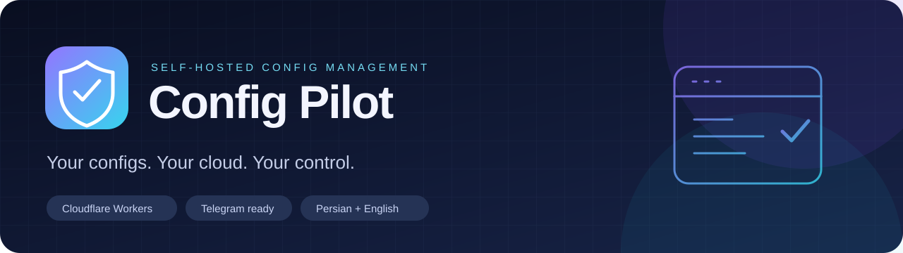
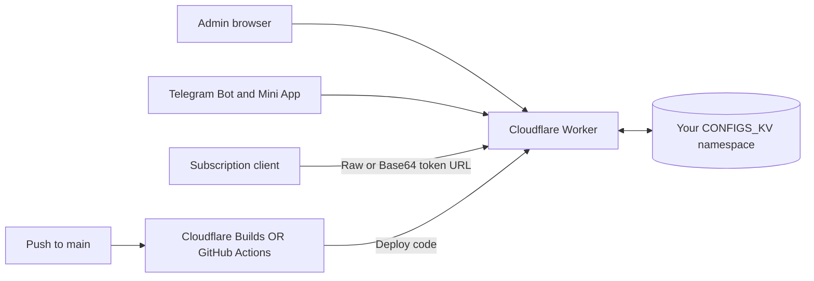

<div align="center">
  
  <h1>Config Pilot</h1>
  <p><strong>A bilingual control panel for your subscription configs. Hosted on your own Cloudflare account.</strong></p>
  <p>
    <a href="https://developers.cloudflare.com/workers/"></a>
    <a href="https://developers.cloudflare.com/kv/"></a>
    <a href="https://core.telegram.org/bots"></a>
    <a href="LICENSE"></a>
    <a href="https://github.com/erfan-tahvilian/config-pilot/actions/workflows/ci.yml"></a>
  </p>
  <p><a href="README.md">English</a> · <a href="README.fa.md">فارسی</a> · <a href="#deploy">🚀 Deploy</a> · <a href="#auto-deploy">🔄 Automatic deployment</a> · <a href="#support">💜 Support</a> · <a href="https://github.com/erfan-tahvilian/config-pilot/issues">🐛 Report an issue</a></p>
</div>

---

A self-hosted subscription-config manager for Cloudflare Workers and KV, with a Persian/English admin panel and Telegram bot. Each operator deploys an independent instance using their own Cloudflare resources.

> Config Pilot stores and distributes configuration text. It does not provision VPN servers, generate working proxy credentials or test remote server availability.

## 📚 Contents

[✨ Features](#features) · [🏗️ Architecture](#architecture) · [🚀 Installation](#deploy) · [🔄 Automatic deployment](#auto-deploy) · [🤖 Telegram](#telegram) · [🌐 Custom domain](#domain) · [🧭 Daily use](#usage) · [💻 Local development](#development) · [🔧 Configuration](#configuration) · [💾 Backup & recovery](#operations) · [🔌 API](#api) · [🛠️ Troubleshooting](#troubleshooting) · [🤝 Contributing](#contributing) · [💜 Support](#support) · [📄 License](#license)

<a id="features"></a>
## ✨ Features

- Create, rename, enable/disable and delete users with independent subscription tokens.
- Manage per-user configs and Raw/Base64 subscription links.
- Upload text files, clean whitespace, deduplicate configs, download TXT and restore the previous saved configs.
- Copy another user's configs during user creation or from an existing user's page. Copies are independent; replacing saved destination configs creates a backup.
- Replace or append configs for all users or selected users, using text, files or another user as the source.
- Persian RTL / English LTR panel; light/dark themes with browser-persisted preferences. Config text and links stay LTR. The button shows a moon in light mode and a sun in dark mode.
- Telegram user/config management, file uploads, bulk operations and Mini App authentication, with a separate persistent bot-language preference.

<a id="architecture"></a>
## 🏗️ Architecture



The panel, API, subscription endpoints and bot webhook run in `worker.js`. Data stays in your own KV namespace. Publishing or updating the repository does not copy your stored users or configs into GitHub.

| Your goal | Start here |
| --- | --- |
| Install and deploy once | [🚀 Manual installation](#deploy) |
| Deploy automatically after a push | [🔄 Cloudflare Builds or GitHub Actions](#auto-deploy) |
| Try it on your machine | [💻 Local development](#development) |
| Upgrade an existing installation | [💾 Maintenance and recovery](#operations) |

<a id="deploy"></a>
## 🚀 Deploy your instance

You need a Cloudflare account with Workers/KV access, Git, and **Node.js 22 or newer** (the included CI uses Node.js 24). A GitHub account/fork is needed for automatic deployment. A Telegram bot and custom domain are optional.

Fork this repository first if you want your own updates and deployment settings. When using a fork, replace the clone URL below with your fork URL.

```sh
git clone https://github.com/erfan-tahvilian/config-pilot.git
cd config-pilot
npm ci
npx wrangler login
```

1. Copy `wrangler.example.toml` to `wrangler.toml`. This personal file is ignored by Git. Choose your Worker name. On macOS/Linux use `cp wrangler.example.toml wrangler.toml`; in PowerShell use `Copy-Item wrangler.example.toml wrangler.toml`.
2. Run `npx wrangler kv namespace create CONFIGS_KV`. Replace `REPLACE_WITH_YOUR_KV_NAMESPACE_ID` in your local config with the returned ID. Keep the binding name **`CONFIGS_KV`**.
3. Set a unique initial password of at least 8 characters as a Cloudflare Secret:

   ```sh
   npx wrangler secret put ADMIN_PASSWORD
   ```

   Enter the password at the prompt. If Wrangler asks to create the Worker on first use, allow it, then continue with the code deployment below. Fresh installations have **no shared default password**. The first successful password login stores its SHA-256 hash in KV. Later logins use the saved password; changing the bootstrap Secret does not overwrite it. Use the panel to change an initialized password. Existing installations retain their saved password; change it if they still use the old `admin` default.

4. Validate and deploy:

   ```sh
   npm test
   npx wrangler deploy --dry-run
   npm run deploy
   ```

5. Open `https://YOUR_WORKER_HOST/admin` and sign in.

The example enables a `workers.dev` URL. If you disable it, configure your own domain/routes. Optional `PUBLIC_BASE_URL` sets the public origin used for generated subscription links.

<a id="auto-deploy"></a>
## 🔄 Deploy automatically when you push to `main`

Choose **one** production deployment method so the same push does not deploy twice. The included [workflow](.github/workflows/ci.yml) always runs tests/build checks; its deployment job stays disabled until you explicitly enable it.

### ☁️ Option A · Cloudflare Workers Builds

First complete the manual setup above. For an existing Worker, open **Workers & Pages → your Worker → Settings → Builds → Connect**, authorize GitHub and select your repository and `main`. The Worker name must match the generated config. See [Cloudflare's connection guide](https://developers.cloudflare.com/workers/ci-cd/builds/).

Use these project-specific settings:

| Field | Value |
| --- | --- |
| Production branch | `main` |
| Root directory | Repository root (`/`) |
| Build command | `npm ci && npm test && npm run configure` |
| Deploy command | `npm run deploy` |
| Build variable `CONFIG_PILOT_KV_NAMESPACE_ID` | Your KV namespace ID |
| Build variable `CONFIG_PILOT_WORKER_NAME` | Your existing Worker's exact name |
| Optional build variable `CONFIG_PILOT_WORKERS_DEV` | `false` to keep the workers.dev endpoint disabled for a custom-domain installation |
| Optional build variable `PUBLIC_BASE_URL` | Your public HTTPS origin |

`npm run configure` generates the ignored `wrangler.toml` from these values. It overwrites that local generated file; it does not write passwords or API tokens. Set **`ADMIN_PASSWORD` as a runtime Secret** in the Worker settings, not merely as a build variable. [Build settings and runtime variables are separate](https://developers.cloudflare.com/workers/ci-cd/builds/configuration/).

Push a commit to `main` and follow the build log in Cloudflare. Keep `DEPLOY_TO_CLOUDFLARE` unset in GitHub if you use this method.

### ⚙️ Option B · The included GitHub Actions workflow

In your repository, open **Settings → Secrets and variables → Actions**. Add:

| Type | Name | Value |
| --- | --- | --- |
| Secret | `CLOUDFLARE_API_TOKEN` | API token scoped to your Cloudflare deployment account |
| Secret | `CLOUDFLARE_ACCOUNT_ID` | Your Cloudflare account ID |
| Secret | `CONFIG_PILOT_KV_NAMESPACE_ID` | Your namespace ID, with no quotes or spaces |
| Secret | `ADMIN_PASSWORD` | Unique initial password, at least 8 characters |
| Variable | `CONFIG_PILOT_WORKER_NAME` | Worker name; defaults to `config-pilot` |
| Variable | `CONFIG_PILOT_WORKERS_DEV` | Optional `true`/`false`; defaults to `true` |
| Variable | `PUBLIC_BASE_URL` | Optional HTTPS origin |
| Variable | `DEPLOY_TO_CLOUDFLARE` | Set to the exact string `true` when ready |

Create an **Edit Cloudflare Workers** API token, restricted to the account you deploy to. For domains/routes, grant the matching zone access as needed. Follow the [official authentication guide](https://developers.cloudflare.com/workers/ci-cd/external-cicd/github-actions/) to locate the account ID and create the token; never use your global API key in the repository.

The workflow uses the [official Wrangler action](https://github.com/cloudflare/wrangler-action), pinned to a commit. It generates the config and uploads `ADMIN_PASSWORD` as a Worker Secret. Tests must pass before deployment. Push to `main`, or select **Actions → Checks and deploy → Run workflow** on `main`. For forks, enable Actions first if GitHub asks. Leave the enable variable unset to run checks without deploying.

### ✅ Verify the result

After a successful deployment, open `/admin`, sign in, create a test user, save a test config and check its Raw link. Confirm the user list survives a subsequent code deployment. Your existing namespace must stay the same; a different namespace represents a different dataset.

<a id="telegram"></a>
## 🤖 Telegram

Create a bot with BotFather. In the panel's Telegram section, enter its token and your numeric admin Telegram ID, enable the bot and save. Saving registers the webhook and command list. Only the configured admin can manage the instance through the bot. Send `/start` to the bot, or use the panel's test-message button.

For the Mini App, register `https://YOUR_WORKER_HOST/tg-app` in BotFather under `/myapps` and open it inside Telegram.

Use **🌐 زبان / Language**, `/language`, `/language en` or `/language fa` to select the bot language. It is saved in KV independently of the panel language. Switching languages preserves pending operations; old reply keyboards in both languages remain accepted. Names, URLs and config contents are never translated.

Use `/help`, `/commands` and `/file` for instructions. Example:

```text
/setconfigs USER_ID
vless://...
```

`USER_ID` is the panel user's internal ID, such as `u_xxxxx`, not your Telegram ID. Get it from user management. You can also send a text file with the command as its caption.

<a id="domain"></a>
## 🌐 Custom domain

Add a domain through **Worker → Settings → Domains & Routes → Add → Custom Domain**. Your domain must be available in your Cloudflare account. See the [official Custom Domains guide](https://developers.cloudflare.com/workers/configuration/routing/custom-domains/).

Set `PUBLIC_BASE_URL` to an origin such as `https://configs.example.com` if generated subscription links should use that host. It does not configure DNS itself. For manual deployments, uncomment `[vars]` in your local config. For automatic deployments, use the variable in the relevant table above. If the bot should use the new host, open the panel on that host and save Telegram settings again; update BotFather's Mini App URL too.

<a id="usage"></a>
## 🧭 Daily use

| Task | Panel workflow |
| --- | --- |
| New empty user | Users → enter name → leave the copy source empty → Create user |
| New user with copied configs | Users → enter name → select optional source user → Create user |
| Copy onto an existing user | User configs → select destination → select another source → Copy configs → confirm |
| Edit configs | Select user → paste or upload → choose normalization/deduplication → Save configs |
| Distribute a subscription | Copy that user's Raw or Base64 URL into a compatible client |
| Bulk update | Choose replace/append, scope and source → Apply configs |
| Restore previous configs | Select destination user → Restore backup → confirm |
| Change appearance | Use the language and theme controls above the panel |

Subscription links are bearer credentials: anyone with the URL can read that user's configs while the user is enabled. Disabling a user stops access. Regenerating the token invalidates the old URL; update your client afterward. Config copies do not copy names, IDs, enabled status or tokens.

<details>
<summary><strong>Telegram command reference</strong></summary>

| Command | Purpose |
| --- | --- |
| `/start`, `/help`, `/commands`, `/file` | Menus and instructions |
| `/language`, `/language fa`, `/language en` | Bot language |
| `/id` | Configured admin Telegram ID |
| `/users`, `/newuser`, `/adduser NAME` | List/create users |
| `/configs ID` | Summary and config preview |
| `/setconfigs ID`, `/appendconfigs ID` | Replace/append from following lines or a file caption |
| `/bulk` | Interactive bulk update |
| `/apply_all`, `/append_all` | Replace/append for all users |
| `/apply_users id1,id2`, `/append_users id1,id2` | Replace/append for selected users |
| `/enable ID`, `/disable ID`, `/deluser ID` | User status/deletion |
| `/password NEW_PASSWORD` | Change panel password; the password is included in the Telegram message |
| `/webhook` | Reconfigure webhook and commands |
| `/cancel` | Cancel a pending operation |

Interactive bot buttons also provide rename, token regeneration and deletion confirmations. Prefer changing the password in the panel when you do not want it present in Telegram chat history.

</details>

<a id="development"></a>
## 💻 Local development

Copy `wrangler.example.toml` to `wrangler.toml`, and `.dev.vars.example` to `.dev.vars`. Replace the example password with your own local password, then run:

```sh
npm ci
npm test
npm run dev
```

Open `/admin` on the local URL printed by Wrangler. Local KV lives under `.wrangler/` and does not use production KV data. Tests use in-memory KV and mock Telegram API requests.

<a id="configuration"></a>
## 🔧 Configuration and data

| Setting | Location | Purpose |
| --- | --- | --- |
| Worker name, KV namespace, routes | Local `wrangler.toml` | Your deployment resources |
| `CONFIGS_KV` | Wrangler KV binding | Users, configs, backups, password hash and bot settings/state |
| `ADMIN_PASSWORD` | Cloudflare Secret / local `.dev.vars` | Initial password for a fresh installation |
| `PUBLIC_BASE_URL` | Optional Wrangler variable | Public origin for generated links |
| Bot token and admin ID | Panel → Telegram; saved in your KV | Optional bot integration |

Real deployment files, `.dev.vars`, `.env` files, logs, dependencies and local KV data are ignored by Git. Never commit real tokens, passwords, exported KV data or subscription links. Each operator must create their own namespace and bot. Config input is limited to 5 MB.

<a id="operations"></a>
## 💾 Backup, updates and recovery

**Backups.** Download each user's TXT before a major change. The in-app restore keeps a previous nonempty saved config; it is not a full namespace backup or version history. To preserve users, tokens, settings and password state too, back up all KV keys **and values** using authenticated Cloudflare KV tooling/API and keep the result outside this repository. A list of key names alone is not a full backup.

**Updates.** Keep the same namespace ID and Worker name. Pull the latest `main`, run `npm ci && npm test`, then deploy. With automatic deployment, pushing to the connected `main` does this through your chosen pipeline. Code deployment does not reset KV. Review upstream changes before merging updates into a fork.

**Rollback.** Use Cloudflare's Worker deployment history, or `npx wrangler rollback VERSION_ID` with your local config. Code rollback does not undo KV writes; restore data separately if necessary. Avoid deploying an old version that is incompatible with newer data.

<details>
<summary><strong>Recover a forgotten panel password (Cloudflare account owner only)</strong></summary>

Set a new initial Secret first, then remove only the stored password hash and metadata from your own namespace:

```sh
npx wrangler secret put ADMIN_PASSWORD
npx wrangler kv key delete admin_password_hash_v1 --binding CONFIGS_KV --remote
npx wrangler kv key delete admin_password_meta_v1 --binding CONFIGS_KV --remote
```

Sign in using the new Secret. This does not remove users or configs. Existing authenticated clients using the old password stop working. Allow for KV propagation before retrying.

</details>

**Existing installations.** Your old `wrangler.toml` remains local when updating a checkout. In a fresh clone, create it from the example using your existing resource IDs. Saved passwords remain valid; only fresh installations require the bootstrap Secret. Replace the old `admin` password if it is still in use.

<a id="api"></a>
## 🔌 Config-copy API

Both endpoints require admin authentication:

- `POST /api/admin/users/create`: `name` and optional `sourceUserId`. Without a source, creates a user with empty configs.
- `POST /api/admin/users/configs/copy`: destination `id` and `sourceUserId`; replaces destination configs through the regular backup/save flow.

Copies preserve source text and retain the destination's identity, token and enabled status. Missing, empty and oversized sources are rejected before destination writes; copying a user onto itself is rejected.

<a id="troubleshooting"></a>
## 🛠️ Troubleshooting

| Symptom | What to check |
| --- | --- |
| `CONFIGS_KV` binding error | Local/generated config has the exact binding and your own namespace ID |
| Fresh login rejected | Runtime `ADMIN_PASSWORD` exists, has at least 8 characters and matches what you entered |
| Changing the Secret did not change login | An initialized instance uses the saved KV hash; change the password inside the panel or use owner recovery |
| Build reports missing namespace ID | Set `CONFIG_PILOT_KV_NAMESPACE_ID` in the selected CI provider; do not leave the template placeholder |
| Cloudflare Worker name mismatch | `CONFIG_PILOT_WORKER_NAME` must match the connected Worker |
| GitHub deployment job skipped | Set repository variable `DEPLOY_TO_CLOUDFLARE=true`; only `main` can deploy |
| Duplicate deployments | Enable only one production pipeline: native Builds or the Actions deploy job |
| Telegram has no response | Check token, numeric admin ID, enabled status and webhook settings; use Send test message |
| Mini App authentication fails | Open `/tg-app` inside Telegram; the BotFather URL, bot token and admin Telegram ID must agree |
| Subscription link fails | Check enabled status, nonempty configs, latest token and correct public origin |
| Changes appear late | KV is eventually consistent; wait before repeating writes from another location |
| Restore unavailable | The user has no previous nonempty saved config |
| Input rejected | The application limits config/file input to 5 MB |

Use `npx wrangler tail` for live diagnostics, without posting credentials or subscription URLs in public issues. KV is optimized for reads and is [eventually consistent](https://developers.cloudflare.com/kv/concepts/how-kv-works/); this application does not provide transactional multi-admin writes. Cloudflare usage and availability depend on your plan; check [current KV limits](https://developers.cloudflare.com/kv/platform/limits/).

<a id="contributing"></a>
## 🤝 Project structure and contributing

```text
worker.js                    Worker routes, panel and Telegram bot
wrangler.example.toml        Public deployment template
.dev.vars.example           Local password template
scripts/configure.mjs       Generate private CI deployment config
test/                       Node.js regression tests
.github/workflows/ci.yml     Tests, build, optional main deployment
docs/assets/banner.svg      README artwork
README.md / README.fa.md     English / Persian guides
LICENSE                     MIT license
```

Run `npm test` before submitting changes. Keep both READMEs and language strings in sync. Report reproducible bugs through [Issues](https://github.com/erfan-tahvilian/config-pilot/issues), using sanitized sample data. Real tokens, account settings, subscription links and exported KV data do not belong in issues or commits. Dependency versions are locked for reproducible installs; review and test upgrades before changing the lockfile.

<a id="support"></a>
## 💜 Support the project

If Config Pilot is useful to you, consider supporting its continued development and maintenance.

<a href="https://buymeacoffee.com/ErfanTahvilian">
  <picture>
    <source media="(prefers-color-scheme: dark)" srcset="docs/assets/support-dark.svg">
    
  </picture>
</a>

<details>
<summary><strong>Support with cryptocurrency</strong></summary>

Use the network shown for each address when sending a contribution.

**Tron · TRX**

```text
TL8WyZLLGu8UraHAT8dCoeMsnzGpX2oAYn
```

**Binance Coin · BNB · BEP20**

```text
0xeC4F61F21238685cC842bC236D86684e5fc2Bc57
```

**Bitcoin · BTC**

```text
bc1q2y9m8y02fqgsr4c6533duwmqtmrhadc8k8mkt4
```

</details>

<a id="license"></a>
## 📄 License

[MIT](LICENSE). You may use, modify and redistribute the project under the license terms.
